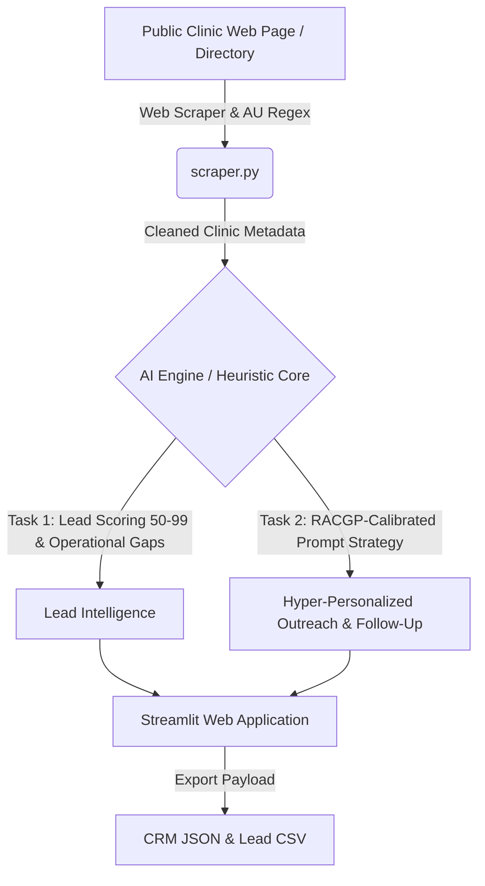

# 🩺 ClinicIQ — AI-Powered Australian GP Intelligence & Growth Platform

[](https://www.python.org/downloads/)
[](https://streamlit.io/)
[-green.svg)]()
[]()
[]()

> **ClinicIQ** (formerly AusHealth Scout) is an intelligent medical practice research, web scraping, and B2B growth automation platform engineered specifically for the **Australian primary healthcare (General Practice)** ecosystem.
>
> Built with **Streamlit**, **Python**, **BeautifulSoup4**, and **OpenAI GPT-4o-mini**, ClinicIQ identifies operational bottlenecks in GP practices and generates hyper-personalized, RACGP-compliant B2B outreach that converts.

---

## 🎯 Key Highlights

* **🇦🇺 Calibrated for Australian Primary Care:** Deep domain context covering **Medicare Benefits Schedule (MBS)** pressures, Bulk Billing vs. Mixed Billing economics, AHPRA requirements, Vocationally Registered (VR) GPs, and MedicalDirector / Best Practice clinical software workflows.
* **🌐 Automated Web Scraping & Ingestion:** Ingests live medical center websites using `BeautifulSoup4` with custom Australian regex parsers for local phone numbers (`07 xxxx xxxx`, `+61`, `1300`), postcodes, billing policies, and 7-day operating hours.
* **🧠 Context-Calibrated AI Engine:** Evaluates clinic profiles, produces a quantified **Lead Score (50–99)**, identifies operational gaps, and recommends high-probability outreach strategies.
* **✉️ Multi-Angle Outreach Generator:** Generates high-converting, consultative cold emails and Day-3 follow-up notes across 3 campaign angles:
  1. *GP Recruitment & Locum Coverage* (solves weekend 7-day doctor shortages)
  2. *AI Front-Desk & Patient Triage Automation* (eliminates receptionist phone queues)
  3. *Allied Health & Practice Expansion* (increases clinical throughput & revenue)
* **🛡️ Zero-Crash Dual-Engine (No API Key Required):** Equipped with an intelligent heuristic fallback engine. The application runs smoothly offline or without an OpenAI API key.
* **🔬 Live Prompt Engineering Lab:** An interactive UI tab showcasing the exact system prompts, temperature controls (0.3–0.4), and iterative prompt evolution history (Naive V1 → Contextual V2 → Production V3).
* **📊 Analytics & CRM Export:** Real-time billing model distributions and one-click JSON/CSV exports for CRM integration.

---

## 🏗️ System Architecture



---

## 🔬 Prompt Engineering Evolution

ClinicIQ's outreach engine was developed through a structured 3-stage prompt refinement process:

| Stage | Version | Prompt Strategy | Identified Failure Mode / Result | Grade |
| :--- | :--- | :--- | :--- | :--- |
| **Stage 1** | **V1: Naive Direct** | Simple sales instruction without context | Generic US-style marketing jargon; hallucinated terms like "pediatrician"; ignored Medicare MBS billing context; rejected as spam. | `3/10 (Poor)` |
| **Stage 2** | **V2: Contextual** | Added location and Australian role | Better tone, but lacked operational depth. Failed to differentiate between Bulk Billing vs. Mixed Billing practices. | `6/10 (Moderate)` |
| **Stage 3** | **V3: Production (RACGP)** | Role calibration + RACGP guardrails + Bottleneck pairing + Few-shot output formatting | Zero hallucination. Consultative Australian tone (*utilise, centre*), low-friction subject lines, Day-3 follow-up cadence, and exportable JSON format. | `10/10 (Production)` |

---

## 📁 Repository Structure

```text
ClinicIQ/
├── app.py                      # Main Streamlit web application & high-contrast UI
├── ai_engine.py                # Dual LLM orchestration, prompt templates & scoring
├── scraper.py                  # BeautifulSoup4 web scraper & Australian regex parser
├── config.toml                 # Streamlit theme configuration (Navy & Teal palette)
├── requirements.txt            # Python package dependencies
├── .gitignore                  # Git ignore rules for venv, cache, and secrets
├── README.md                   # Project documentation & overview
└── data/
    └── seed_clinics.py         # Curated Australian GP dataset (QLD, NSW, VIC)
```

---

## 🛠️ Installation & Setup (Under 2 Minutes)

### 1. Clone the Repository
```bash
git clone https://github.com/YOUR_USERNAME/ClinicIQ.git
cd ClinicIQ
```

### 2. Create and Activate a Virtual Environment
```bash
# Windows
python -m venv .venv
.venv\Scripts\activate

# macOS / Linux
python3 -m venv .venv
source .venv/bin/activate
```

### 3. Install Dependencies
```bash
pip install -r requirements.txt
```

### 4. (Optional) Configure OpenAI API Key
ClinicIQ includes a full heuristic fallback engine and works **100% out of the box without an API key**. 

If you wish to use live OpenAI GPT-4o-mini:
```bash
# Windows (PowerShell)
$env:OPENAI_API_KEY="your-api-key-here"

# macOS / Linux
export OPENAI_API_KEY="your-api-key-here"
```

### 5. Launch the Application
```bash
streamlit run app.py
```
The dashboard will open automatically in your browser at `http://localhost:8501`.

---

## 🖥️ Application Modules

* **📋 Practice Directory:** Browse and filter Australian medical practices by State (QLD, NSW, VIC) and Billing Model (Bulk, Mixed, Private). Launch AI bottleneck analyses on any practice.
* **🌐 Data Ingestion:** Scrape live Australian medical websites or run the directory simulator to extract clinic names, phones, hours, and billing types into the intelligence database.
* **✉️ Outreach Engine:** Select a practice and choose from 3 tailored B2B growth campaigns to generate emails with low-friction CTAs and 3-day follow-ups.
* **🔬 Prompt Lab:** View the production system prompt, parameter strategy (temperature 0.3–0.4), and examine the 3-stage prompt evolution.
* **📊 Analytics:** Visual analytics showing billing distributions and state breakdowns with one-click CSV export.

---

## 🛡️ Tech Stack

* **Frontend & Dashboard:** [Streamlit](https://streamlit.io/) with custom BaseWeb high-contrast CSS overrides
* **Data Scraping & Ingestion:** [BeautifulSoup4](https://www.crummy.com/software/BeautifulSoup/), [Requests](https://requests.readthedocs.io/), Regular Expressions (Regex)
* **Data Processing:** [Pandas](https://pandas.pydata.org/)
* **AI & LLM Orchestration:** [OpenAI Python SDK](https://github.com/openai/openai-python) (GPT-4o-mini) + Rule-Based Heuristic Engine

---

## 📄 License

This project is licensed under the [MIT License](LICENSE).

---

*Engineered with precision for Australian Healthcare Intelligence & AI Growth Automation.*
